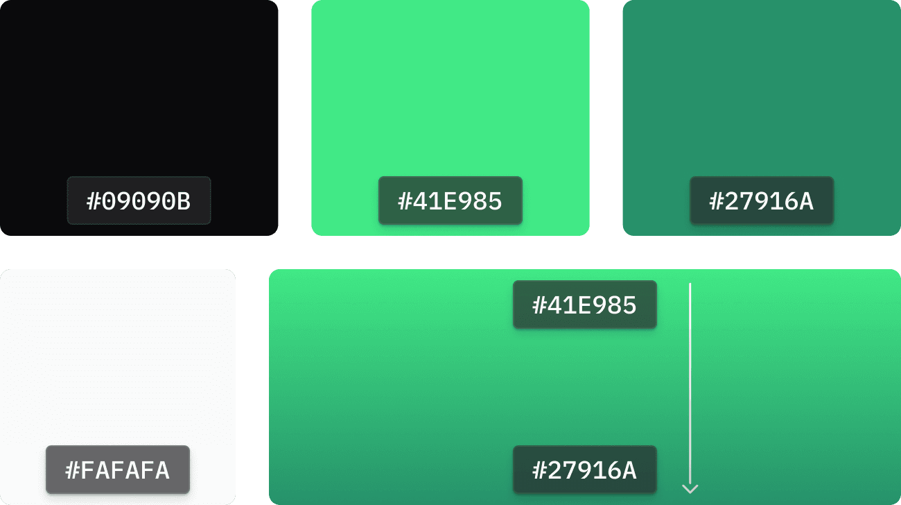

# GameGlass Brand Guide

Resources for presenting the GameGlass brand consistently.

[**Download all assets (ZIP)**](https://github.com/GameGlass/brand-guide/archive/refs/heads/main.zip)

## Usage terms

The GameGlass name, logos, and the assets in this repository are trademarks of GameGlass Inc. They are not open source. You may use them to refer to GameGlass, to show compatibility with GameGlass, or as a GameGlass partner, provided you follow this guide and the [Brand Asset Usage Terms](LICENSE.md). Any other use requires written permission from GameGlass.

## Naming

"GameGlass" is a single word always spelled with a capital G for "Game", followed by another capital G for "Glass". The abbreviation "GG" is also appropriate when the full name "GameGlass" has already been established.

It also references the acronym commonly used in gaming "Good Game", which is a value we take to heart here at GameGlass.

## Usage

Provide plenty of space around the GameGlass logo and other GG assets. When cluttered, they may look too busy. Big or small is fine, just be sure to use the proper asset in the proper context.

## GameGlass colors

We are fans of being dark and mysterious. The GameGlass brand pops on darker backgrounds, so if possible that's what you want to use. Our primary dark background color is `#09090B`.



| Name             | Hex       | Use                                          |
| ---------------- | --------- | -------------------------------------------- |
| Dark background  | `#09090B` | Primary background color                     |
| Green            | `#41E985` | Primary brand green, top of the gradient     |
| Dark green       | `#27916A` | Secondary brand green, bottom of the gradient |
| Light background | `#FAFAFA` | Light background, used for grayscale marks   |

The brand gradient runs top to bottom from `#41E985` to `#27916A`.

## GameGlass wordmark

The GG wordmark should be the primary asset used when there is enough space to easily read the text. The green gradient logo should only be used on a dark background.

Click a preview to open the SVG. The on-black variants are transparent with white text, so they are only visible when viewing this page in a dark theme.

<table>
  <tr><th>Primary (dark background)</th><th>Grayscale on black</th><th>Grayscale on white</th></tr>
  <tr><td align="center"><a href="assets/GG-LogoMark-primary-on-black.svg"></a></td><td align="center"><a href="assets/GG-LogoMark-grayscale-on-black.svg"></a></td><td align="center"><a href="assets/GG-LogoMark-grayscale-on-white.svg"></a></td></tr>
  <tr><td align="center"><a href="assets/GG-LogoMark-primary-on-black.svg">SVG</a> · <a href="assets/GG-LogoMark-primary-on-black.png">PNG</a> · <a href="assets/@2x/GG-LogoMark-primary-on-black@2x.png">@2x</a> · <a href="assets/@3x/GG-LogoMark-primary-on-black@3x.png">@3x</a></td><td align="center"><a href="assets/GG-LogoMark-grayscale-on-black.svg">SVG</a> · <a href="assets/GG-LogoMark-grayscale-on-black.png">PNG</a> · <a href="assets/@2x/GG-LogoMark-grayscale-on-black@2x.png">@2x</a> · <a href="assets/@3x/GG-LogoMark-grayscale-on-black@3x.png">@3x</a></td><td align="center"><a href="assets/GG-LogoMark-grayscale-on-white.svg">SVG</a> · <a href="assets/GG-LogoMark-grayscale-on-white.png">PNG</a> · <a href="assets/@2x/GG-LogoMark-grayscale-on-white@2x.png">@2x</a> · <a href="assets/@3x/GG-LogoMark-grayscale-on-white@3x.png">@3x</a></td></tr>
</table>

## GameGlass Logo

For tight layouts or logo-only grids, the GameGlass logomark is a concise way to refer to GameGlass. Use with good judgment for your audience.

<table>
  <tr><th>Primary (dark background)</th><th>Grayscale on black</th><th>Grayscale on white</th></tr>
  <tr><td align="center"><a href="assets/GG-BrandMark-Primary_on_black.svg"></a></td><td align="center"><a href="assets/GG-BrandMark-Grayscale_on_black.svg"></a></td><td align="center"><a href="assets/GG-BrandMark-Grayscale_on_white.svg"></a></td></tr>
  <tr><td align="center"><a href="assets/GG-BrandMark-Primary_on_black.svg">SVG</a> · <a href="assets/GG-BrandMark-Primary_on_black.png">PNG</a> · <a href="assets/@2x/GG-BrandMark-Primary_on_black@2x.png">@2x</a> · <a href="assets/@3x/GG-BrandMark-Primary_on_black@3x.png">@3x</a></td><td align="center"><a href="assets/GG-BrandMark-Grayscale_on_black.svg">SVG</a> · <a href="assets/GG-BrandMark-Grayscale_on_black.png">PNG</a> · <a href="assets/@2x/GG-BrandMark-Grayscale_on_black@2x.png">@2x</a> · <a href="assets/@3x/GG-BrandMark-Grayscale_on_black@3x.png">@3x</a></td><td align="center"><a href="assets/GG-BrandMark-Grayscale_on_white.svg">SVG</a> · <a href="assets/GG-BrandMark-Grayscale_on_white.png">PNG</a> · <a href="assets/@2x/GG-BrandMark-Grayscale_on_white@2x.png">@2x</a> · <a href="assets/@3x/GG-BrandMark-Grayscale_on_white@3x.png">@3x</a></td></tr>
</table>

### No padding

The same logomark cropped to its edges, for layouts that manage their own spacing.

<table>
  <tr><th>Primary (dark background)</th><th>Grayscale on black</th><th>Grayscale on white</th></tr>
  <tr><td align="center"><a href="assets/GG-BrandMark-Primary_on_black-nopadding.svg"></a></td><td align="center"><a href="assets/GG-BrandMark-Grayscale_on_black-nopadding.svg"></a></td><td align="center"><a href="assets/GG-BrandMark-Grayscale_on_white-nopadding.svg"></a></td></tr>
  <tr><td align="center"><a href="assets/GG-BrandMark-Primary_on_black-nopadding.svg">SVG</a> · <a href="assets/GG-BrandMark-Primary_on_black-nopadding.png">PNG</a></td><td align="center"><a href="assets/GG-BrandMark-Grayscale_on_black-nopadding.svg">SVG</a> · <a href="assets/GG-BrandMark-Grayscale_on_black-nopadding.png">PNG</a></td><td align="center"><a href="assets/GG-BrandMark-Grayscale_on_white-nopadding.svg">SVG</a> · <a href="assets/GG-BrandMark-Grayscale_on_white-nopadding.png">PNG</a></td></tr>
</table>

## GameGlass Icon

When referring to GameGlass as a company, such as on social media, or where a "chip" design is required, it is acceptable to use this stylized icon with an appropriate corner radius.

<table>
  <tr><th>Square</th><th>Rounded</th><th>Maskable</th></tr>
  <tr><td align="center"><a href="assets/GG-Icon-Square.svg"></a></td><td align="center"><a href="assets/GG-Icon-Rounded.svg"></a></td><td align="center"><a href="assets/GG-Icon-Square-Maskable.svg"></a></td></tr>
  <tr><td align="center"><a href="assets/GG-Icon-Square.svg">SVG</a> · <a href="assets/GG-Icon-Square.png">PNG</a> · <a href="assets/GG-Icon-Square-512.png">512</a> · <a href="assets/@2x/GG-Icon-Square@2x.png">@2x</a> · <a href="assets/@3x/GG-Icon-Square@3x.png">@3x</a></td><td align="center"><a href="assets/GG-Icon-Rounded.svg">SVG</a> · <a href="assets/GG-Icon-Rounded.png">PNG</a> · <a href="assets/GG-Icon-Rounded-114.png">114</a> · <a href="assets/GG-Icon-Rounded-256.png">256</a> · <a href="assets/GG-Icon-Rounded-512.png">512</a> · <a href="assets/@2x/GG-Icon-Rounded@2x.png">@2x</a> · <a href="assets/@3x/GG-Icon-Rounded@3x.png">@3x</a></td><td align="center"><a href="assets/GG-Icon-Square-Maskable.svg">SVG</a> · <a href="assets/GG-Icon-Square-Maskable.png">PNG</a> · <a href="assets/GG-Icon-Square-Maskable-1024.png">1024</a></td></tr>
</table>

## CSS variables

The brand colors are available as CSS custom properties in [`brand.css`](brand.css).

```css
@import "brand.css";

body {
  background: var(--gg-color-background-dark);
  color: var(--gg-color-background-light);
}

.hero {
  background: var(--gg-gradient-green);
}
```

| Variable                      | Value                                   |
| ----------------------------- | --------------------------------------- |
| `--gg-color-background-dark`  | `#09090B`                               |
| `--gg-color-background-light` | `#FAFAFA`                               |
| `--gg-color-green`            | `#41E985`                               |
| `--gg-color-green-dark`       | `#27916A`                               |
| `--gg-gradient-green`         | 180deg gradient, `#41E985` to `#27916A` |
